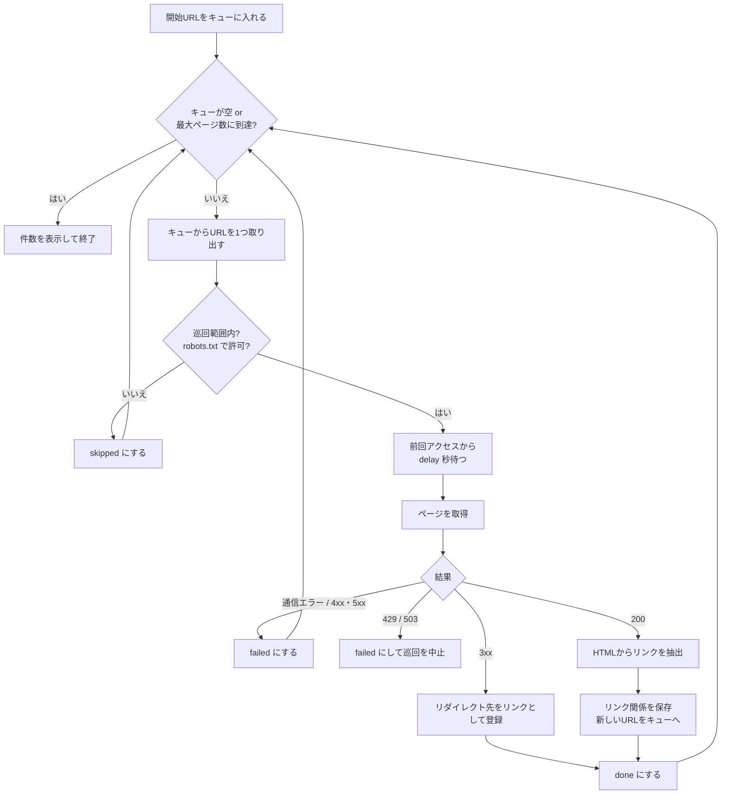

# URL Collector

Webサイトのリンク構造を自動で収集する、学習用の小さなWebクローラーです。
「巡回キュー」「重複排除」「SQLiteでのデータ管理」「robots.txt の尊重」といった、
クローラーの基本的な仕組みを、短いコードで追えるように作っています。

- Python 3.11 以上 / requests / BeautifulSoup / SQLite
- 最初は **10ページ程度** の小規模巡回から
- 外部サイトに出る前に、**同梱のサンプルサイトでローカルに試せる**

---

## できること

| # | 機能 | 担当ファイル |
|---|------|------|
| 1 | 開始URLを設定ファイルで指定 | `config.toml`, `config.py` |
| 2 | HTMLからリンクURLを抽出 | `parser.py` |
| 3 | 巡回キューで未処理URLを管理 | `frontier.py` |
| 4 | 同じURLを重複して巡回しない | `url_utils.py`（正規化）, `frontier.py`（既出チェック） |
| 5 | リンク元→リンク先の関係をSQLiteに保存 | `storage.py`, `schema.sql` |
| 6 | 最大巡回ページ数・アクセス間隔を設定 | `config.toml`, `crawler.py` |
| 7 | 処理済み・未処理・失敗件数を表示 | `cli.py` |
| 8 | robots.txt・アクセス制限を尊重し、許可範囲だけ巡回 | `robots.py`, `url_utils.py`（Scope）, `crawler.py` |

---

## セットアップ

```bash
git clone <このリポジトリのURL>
cd url-collector

python -m venv .venv
source .venv/bin/activate        # Windows: .venv\Scripts\activate

pip install -r requirements-dev.txt   # 実行だけなら requirements.txt でOK
```

## まずローカルで試す

ターミナルを **2つ** 開きます。

**ターミナル1**：サンプルサイトを配信する（Python 標準の簡易Webサーバー）

```bash
python -m http.server 8000 --directory sample_site
```

**ターミナル2**：巡回する

```bash
python main.py crawl --reset
```

出力例:

```
巡回開始 (最大 10 ページ / 間隔 1.0 秒)
[  1/10] 200 http://localhost:8000/index.html  (リンク 6件 / キュー残り 5件)
[  2/10] 200 http://localhost:8000/about.html  (リンク 2件 / キュー残り 5件)
[  3/10] 200 http://localhost:8000/blog/  (リンク 3件 / キュー残り 6件)
[skip] robots.txt で禁止: http://localhost:8000/private/secret.html
[  4/10] 404 http://localhost:8000/missing.html  (失敗)
...
[  9/10] 301 http://localhost:8000/blog  → http://localhost:8000/blog/

=== 件数 ===
  処理済み (done)    :     8
  未処理   (pending) :     0
  失敗     (failed)  :     1
  除外     (skipped) :     2
  リンク関係         :    18
```

サンプルサイト (`sample_site/`) には、確認したいケースをわざと入れてあります。

| リンク | 期待される動き |
|---|---|
| `about.html` / `about.html#team` / `./about.html` | 正規化で同じURLになり、1回だけ巡回 |
| `private/secret.html` | robots.txt で禁止 → `skipped`（アクセスしない） |
| `missing.html` | 存在しない → 404 で `failed` |
| `https://example.com/` | 巡回範囲外 → `skipped`（アクセスしない。リンク関係は保存） |
| `mailto:...` | URLではないので無視 |
| `files/sample.txt` | HTMLではないので取得のみ、リンク抽出なし |
| `/blog`（末尾スラッシュなし） | 301 リダイレクト → リダイレクト先をキューへ |

## コマンド

```bash
python main.py crawl            # 巡回（前回の続きから再開）
python main.py crawl --reset    # DBを空にして最初から巡回
python main.py stats            # 件数と、被リンク数の多いページを表示
python main.py --config other.toml crawl   # 別の設定ファイルを使う
```

巡回中に `Ctrl+C` で止めても、次に `crawl` すれば未処理URLから再開します。

## 設定ファイル (`config.toml`)

```toml
[crawler]
start_urls = ["http://localhost:8000/index.html"]  # 開始URL（複数可）
max_pages = 10            # 1回の実行で取得する最大ページ数
delay_seconds = 1.0       # 同じサイトへのアクセス間隔（秒）
timeout_seconds = 10      # 1ページの待ち時間の上限（秒）
user_agent = "URLCollector/0.1 (learning project)"
allowed_domains = []      # 空なら開始URLと同じドメインだけ巡回

[database]
path = "data/crawl.db"    # 保存先（Git管理対象外）
```

## 結果をSQLで見る

```bash
sqlite3 data/crawl.db
```

```sql
-- 状態ごとの件数
SELECT status, COUNT(*) FROM pages GROUP BY status;

-- どのページからどのページへリンクしているか
SELECT s.url AS リンク元, t.url AS リンク先
FROM links l
JOIN pages s ON s.id = l.source_id
JOIN pages t ON t.id = l.target_id;

-- 失敗・除外の理由
SELECT url, status, http_status, note FROM pages WHERE status IN ('failed', 'skipped');
```

`sqlite3` コマンドが無い場合は、[DB Browser for SQLite](https://sqlitebrowser.org/) などのGUIツールでも開けます。

---

## 仕組み

### 巡回の流れ



### URLの状態

DBの `pages.status` は次の4つです。

```
pending ──取得成功──▶ done
   │
   ├──取得失敗──▶ failed
   └──範囲外 / robots.txt で禁止──▶ skipped
```

### 重複巡回を防ぐ2段構え

1. **正規化**（`url_utils.normalize_url`）
   `HTTP://Example.com:80/a#top` と `http://example.com/a` のような「表記ゆれ」を同じ文字列にそろえる。
2. **既出チェック**（`Frontier` の `set` と、DBの `UNIQUE` 制約）
   一度キューに入れたURLは二度と入れない。DBにも同じURLは1行しか入らない。

### キューは幅優先 (FIFO)

`collections.deque` を使い、先に見つけたURLから順に取り出します。
開始ページに近いページから巡回するので、`max_pages` が小さくても「サイトの入口付近」をまんべんなく集められます。

### 礼儀正しく巡回するために

- **robots.txt** を最初に読み、禁止されたパスにはアクセスしない（`Crawl-delay` があればそれも守る）
- robots.txt が 401/403 や 5xx のときは、安全側に倒して**そのサイト全体を巡回しない**
- 同じホストには **`delay_seconds` 以上の間隔** をあける
- **429 (Too Many Requests) / 503** が返ったら、その場で巡回を中止する
- リダイレクトは自動で追わず、リダイレクト先も範囲・robots.txt チェックを通してから取得する
- 巡回範囲（`allowed_domains`）の外へは出ない
- HTML以外（画像など）は本文をダウンロードしない

### DB設計

```
pages                                  links
┌──────────────┬─────────┐             ┌───────────┬─────────┐
│ id (PK)      │ INTEGER │◀────────────│ source_id │ INTEGER │ リンク元
│ url (UNIQUE) │ TEXT    │◀────────────│ target_id │ INTEGER │ リンク先
│ status       │ TEXT    │             └───────────┴─────────┘
│ http_status  │ INTEGER │              PRIMARY KEY (source_id, target_id)
│ note         │ TEXT    │
│ discovered_at│ TEXT    │
│ fetched_at   │ TEXT    │
└──────────────┴─────────┘
```

URLを `pages` に1回だけ持ち、リンク関係は `links` に id の組で持ちます（正規化）。
定義は `url_collector/schema.sql` にあります。

---

## ファイル構成と役割

```
url-collector/
├── main.py                  実行の入口。cli.py を呼ぶだけ
├── config.toml              設定ファイル（開始URL・最大ページ数・間隔など）
├── requirements.txt         実行に必要なライブラリ
├── requirements-dev.txt     開発用（テストの pytest を追加）
├── pyproject.toml           プロジェクト情報と pytest の設定
├── .gitignore               Git管理しないもの（収集DBなど）
├── .github/workflows/
│   └── test.yml             GitHubにpushすると自動でテストを実行
├── url_collector/           本体のパッケージ
│   ├── cli.py               コマンド（crawl / stats）の処理と件数表示
│   ├── config.py            config.toml を読み、値をチェックする
│   ├── crawler.py           ★巡回の流れ全体。まずここを読むと全体像がつかめる
│   ├── frontier.py          巡回キュー。未処理URLの行列と既出URLの記録
│   ├── fetcher.py           1ページをダウンロードする（requests）
│   ├── parser.py            HTMLからリンクを取り出す（BeautifulSoup）
│   ├── robots.py            robots.txt を読んで、巡回してよいか判定する
│   ├── url_utils.py         URLの正規化と、巡回範囲（Scope）の判定
│   ├── storage.py           SQLiteへの保存と集計
│   └── schema.sql           テーブル定義
├── sample_site/             ローカルテスト用のサンプルサイト（robots.txt 付き）
├── tests/                   自動テスト（pytest）
│   ├── conftest.py          sample_site を配信するテスト用サーバー
│   ├── test_url_utils.py    URL正規化・範囲判定
│   ├── test_parser.py       リンク抽出
│   ├── test_frontier_storage.py  キューとDB
│   └── test_crawler.py      サンプルサイトを実際に巡回するテスト
└── data/                    収集DBの保存先（中身はGit管理対象外）
```

おすすめの読む順番：`crawler.py` → `frontier.py` → `parser.py` / `url_utils.py` → `storage.py` → `robots.py`

各部品は役割ごとに分かれていて、`crawler.py` が組み合わせています。
たとえば「保存先をCSVにしたい」なら `storage.py`、「リンクの取り出し方を変えたい」なら `parser.py` だけを触れば済みます。

## テスト

```bash
pytest -v
```

テストは `sample_site/` を一時的なローカルサーバーで配信して巡回するので、**外部サイトにはアクセスしません**。

---

## 外部サイトを巡回するときは

1. まず `max_pages = 10`、`delay_seconds` は **1秒以上** で始める
2. `allowed_domains` で範囲をはっきり決める
3. 対象サイトの利用規約でクローリングが禁止されていないか確認する
4. `user_agent` に連絡先（GitHubリポジトリのURLなど）を入れると、相手が問い合わせできて親切
5. 自分が管理するサイトや、クローラー練習用に公開されているサイトから試すのがおすすめ

## GitHub に上げる

```bash
git init
git add .
git commit -m "Initial commit: URL Collector"
git branch -M main
git remote add origin https://github.com/<ユーザー名>/url-collector.git
git push -u origin main
```

`data/crawl.db` は `.gitignore` で除外済みです。`git status` に出てこないことを確認してください。

---

## 拡張のアイデア（段階的に）

**ステップ1：見える化**
- CSV / JSON へのエクスポート（`storage.py` にメソッド追加）
- `pages` に `<title>` や巡回の深さ (`depth`) を保存する
- 最大深さ (`max_depth`) の設定

**ステップ2：巡回の質**
- `<meta name="robots" content="nofollow">` や `rel="nofollow"` を尊重
- sitemap.xml から開始URLを読み込む
- 失敗したURLのリトライ（回数上限つき）
- `logging` モジュールでログをファイルに出す

**ステップ3：規模を広げる**
- キューもDBに持たせて、完全に再開可能にする
- 複数サイトを並行で巡回（ホストごとの間隔は守る）
- リンク構造をグラフとして可視化（networkx, Graphviz など）
